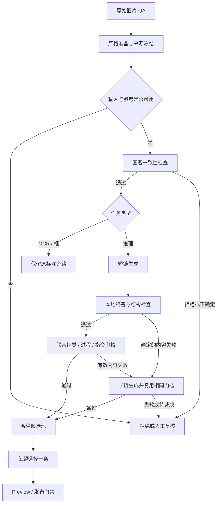

# DataStudio · 图片 CoT SFT 数据构建

基于 [Open-Bee/DataStudio](https://github.com/Open-Bee/DataStudio) 的可选扩展：从已有图片 QA
构建可追溯、可审核的短/长 CoT，导出用于 SFT 的 JSONL。本分支入口是
[`run_image_cot.py`](run_image_cot.py)，不是上游清洗示例的 `run.py`。

**当前分支：`codex/image-cot-v1`。** 已完成本地实现验证；真实教师效果、生产吞吐与学生训练收益待验证。

| 阅读目标 | 文档 |
|---|---|
| 从安装开始，一步一步运行 | **[详细操作手册](docs/image_cot_operations_manual.md)** |
| 理解模块、实现取舍和边界 | [实现说明](docs/image_cot_implementation.md) |
| 查看测试范围和证据 | [523 项本地验证记录](docs/image_cot_validation_2026-11-05.md) |
| 使用上游通用数据清洗框架 | [原中文指南](docs/guide/readme_zh.md) |

## 1. 这个项目解决什么问题

输入已经存在的图片、问题和参考答案。教师生成时不读取参考答案；生成后检查终答、视觉依据、
关键推理与指令完整性，再决定接受、拒绝、人工复核或升级长链。训练输出保留审核通过的正文。

适用于选择题、数值题和已有可靠参考的开放式视觉推理。纯 OCR 转写和框坐标任务走原标注旁路，
单独记录，不强行制造推理。首版每题只选一条合格链，控制重复曝光。

Honey-Data-V2 是配方参考。本扩展复用 DataStudio 算子与 API 引擎，但不声称一键复现其完整生产配方。
与学生 DeepSeek/GLM 的实际训练接线通过独立 probe 验证，API 的 thinking 开关不代替 SFT 编码验证。

## 2. 当前能力与状态

| 能力 | 当前行为 |
|---|---|
| 输入 | 显式单图、单轮、human/gpt QA JSONL；原标注和媒体只读 |
| 自部署教师 | IP＋端口＋served model 名，OpenAI-compatible 图文 Chat Completions |
| DeepSeek 验证 | 内置官方 API profile；请求模型 ID `deepseek-flash`；环境变量鉴权 |
| 生成 | 一条短链；有效内容失败或复杂源白名单才计划一条长链 |
| 审核 | 本地结构/终答检查＋一次联合看图审核；技术错误和不确定结果不放行 |
| 可追溯性 | 稳定题目/候选/任务 ID，源摘要、原始回执、审核与提交引用 |
| 恢复 | intent/receipt 追加日志、不可变分片及 commit manifest；未决请求不自动重发 |
| 复用 | 显式 `reuse_from`；更换审核可复用生成；导出可独立执行 |
| 输出 | 私有 preview、带证据门禁的 release staging、无覆盖发布 |
| 本地验证 | Windows/Python 3.13.9：56 项扩展＋467 项上游测试，共 523 项通过 |
| 尚未验收 | 真实端点、代表性 CoT 人审、生产速率、目标 SFS、学生训练 |

不包含多图/多轮、Honey 嵌套格式导入、交错裁图、PRM、GRPO、自动重发未知请求或在线学生训练。

## 3. 数据产出链路



图中省略了技术失败和 uncertain 的旁路：它们进入 pending/review，不触发长链。
复杂源白名单可以在短链通过后额外生成一条长链作对照，仍默认优先选择通过的短链。

## 4. 安装与第一次运行

克隆包含扩展的分支：

```bash
git clone --branch codex/image-cot-v1 https://github.com/Tiachi/DataStudio.git
cd DataStudio
```

Python 要求 >=3.10；本地验证版本为 3.13.9。实际 Linux/共享存储仍须验证。

Linux/macOS：

```bash
python3 -m venv .venv
.venv/bin/python -m pip install -r requirements-image-cot-dev.txt
.venv/bin/python -m pytest tests/image_cot -q
```

Windows PowerShell：

```powershell
python -m venv .venv
.\.venv\Scripts\python.exe -m pip install -r requirements-image-cot-dev.txt
.\.venv\Scripts\python.exe -m pytest tests/image_cot -q
```

这些测试只用合成小图及 `127.0.0.1` 模拟服务，不调用付费教师。安装依赖需要网络。
后文使用 `python` 简写，请替换为上述虚拟环境解释器，或先激活对应虚拟环境。

第一次操作建议先按手册的 [离线 mock 示例](docs/image_cot_operations_manual.md#quickstart) 跑通：

```bash
python run_image_cot.py check -c /private/config/cot_demo.py --backend mock
python run_image_cot.py run -c /private/config/cot_demo.py --backend mock --limit 1
python run_image_cot.py report --run /private/work/runs/JOB_ID
python run_image_cot.py export --run /private/work/runs/JOB_ID --preview
```

上述路径需要替换为自己的私有路径。完整配置在手册中；仓库的
[base.py](configs/image_cot/base.py) 和 [pilot.py](configs/image_cot/pilot.py) 故意保留 `None` 预算，
不能未经填写就调用真实接口。mock 是控制流验证，其输出不能作为合格训练数据。

## 5. 输入与输出

输入结构示意：

```json
{"id":"source_1","conversations":[{"from":"human","value":"<image>\nHow many groups are shown?"},{"from":"gpt","value":"2"}],"images":["images/my_source/1.png"],"category":"counting"}
```

关键约束：

- 每行一个 JSON 对象，恰好一组 human/gpt、一张图、一个 `<image>`。
- `images` 是相对于 source `media_root` 的路径，媒体必须存在、可解码且不逃逸该根。
- 参考等级和题型由源政策声明，不从教师回答反推；选择题需要显式选项映射。
- 不接受把 Honey 的 `data[]/messages` 不经适配直接喂进来。

输出 `data.jsonl` 使用 `id/conversations/images/modal_mask=1`，原始字段按明确映射保留顶层。
审核通过的 CoT 正文不会在导出时删推理、修标签或改写事实。原始回执、费用和 token 统计留在私有侧车/工作目录。

```text
private_work_root/
├── prepared/<input_digest>/       # 源快照及 input_manifest.json
└── runs/<job_id>/
    ├── run.json                   # 配置与代码身份
    ├── parts/                     # intent / receipt / results / commit
    ├── selection/                 # 每题终态与所选候选
    ├── report.json                # 构建摘要
    ├── reports/                   # 本次执行计时
    └── export_staging/<release>/  # data.jsonl / provenance.jsonl / README / manifest
```

工作根必须在代码仓库之外，也不能与源标注/媒体目录重叠。不要把数据和回执提交到 Git。

## 6. 两种教师接入

自部署连接示意，放在私有 Python 配置中：

```python
image_cot["connections"]["lan_teacher"] = {
    "provider_profile": "openai_compatible",
    "ip": "10.0.0.8", "port": 8000,
    "model": "actual-served-model-name",
    "auth": {"mode": "none"},
}
```

默认得到 `http://10.0.0.8:8000/v1/chat/completions`；需要鉴权时用 `env_bearer/key_env`。
服务必须真正支持图片、指定模型及已声明参数，普通 HTTP 200 不证明视觉能力。

DeepSeek profile 使用 `https://api.deepseek.com`、空 prefix、`model="deepseek-flash"`，
从 `DEEPSEEK_API_KEY` 读取 key。`pilot.py` 显式关闭短链/审核 thinking，长链开启 high；
这些是验证起点，不是质量或速度最优值。详情见手册的 [教师接入](docs/image_cot_operations_manual.md#teachers)。

## 7. 命令速查

| 命令 | 作用 | 是否可能请求教师 |
|---|---|---|
| `check -c CONFIG` | 配置预检，不检查端点连通 | 否 |
| `prepare -c CONFIG --limit N` | 严格读取和冻结输入 | 否 |
| `run -c CONFIG --limit N` | 自动准备并执行流水线 | HTTP 后端会；mock 不会 |
| `resume --run RUN` | 以原身份恢复，保留未决请求 | 对从未派发的任务可能会 |
| `report --run RUN` | 读取构建摘要 | 否 |
| `export --run RUN --preview` | 私有预览 | 否 |
| `export --run RUN -c EXPORT --stage-release` | 通过全部门禁后准备 release | 否 |
| `export --run RUN -c EXPORT --publish` | 发布到显式目标，manifest 最后提交 | 否 |

`--limit` 不是费用上限；请求数、输出 token、时长与配额必须另行配置。
未知请求不自动重发，不代表 `resume` 完全不发新请求。

## 8. 质量、恢复与正式交付

终答一致只是一项条件。联合审核还检查关键视觉事实、关系/公式、必要推理和任务要求。
缺键、非法枚举、重复 key、NaN、截断、重复推理编码和自相矛盾证据都不放行。
同一模型生成与自审仍可能共同犯错，必须随机抽检通过件并分层人工校准。

恢复要求原提交、代码摘要、干净/脏状态一致，并保留原外部文件。长任务使用冻结 checkout，
升级另开目录；不要在运行目录内直接 pull 或修改正在使用的 prompt。
更换 judge 的 `request_revision` 并显式 `reuse_from` 可重审而不重付生成费用。

正式发布需要真实人审质量报告、实际学生编码/loss/forward-backward probe、
当前项目格式规范及完成的权威 README 验证。至少 300 个独立题组零严重错误的门槛是本版政策，
不是对整个数据集“保证正确”。完整字段与操作顺序见 [发布章节](docs/image_cot_operations_manual.md#release)。

## 9. 开发与文档校验

```bash
python -m pytest tests/image_cot -q
python tools/check_image_cot_docs.py
```

文档检查器可选执行手册里的 mock 示例，自动生成私有合成输入；详见
[文档示例验证](docs/image_cot_operations_manual.md#doc-validation)。它不调用外部 API。

## 10. 上游、许可证与原框架入口

本项目复用 Open-Bee DataStudio，遵循 [Apache License 2.0](LICENSE)。
原框架介绍与旧 `run.py` 示例保留在下方；其中并发、LMDB、checkpoint 描述属于上游路径，
不能直接作为本扩展的生产质量/吞吐承诺。
Honey 方法背景见 [Bee 项目](https://open-bee.github.io/) 和
[Honey-Data-V2](https://huggingface.co/datasets/HoneyDataV2/Honey-Data-V2)。

<details>
<summary>展开原框架 README 与旧入口示例</summary>

<p align="center">
  
</p>

<p align="center">
  <strong>Config-driven multimodal data processing pipeline for MLLMs</strong>
</p>

---

<p align="center">
  <a href="https://arxiv.org/abs/2510.13795"></a>
  <a href="https://open-bee.github.io/"></a>
  <a href="https://huggingface.co/Open-Bee"></a>
  <br/>
  <a href="https://github.com/Open-Bee/DataStudio"></a>
  <a href="https://github.com/Open-Bee/DataStudio/blob/main/LICENSE"></a>
  <a href="https://www.python.org/"></a>
</p>

<p align="center">
  <a href="docs/guide/readme_zh.md">简体中文</a> | <a href="https://open-bee.github.io/DataStudio/">Documentation</a>
</p>

---

## Introduction

**DataStudio** is a data processing toolkit for Multimodal Large Language Models (MLLMs). It supports both rule-based and MLLM-powered operators for filtering and rewriting data. DataStudio drives the HoneyPipe data cleaning pipeline that produced [Honey-Data-15M](https://huggingface.co/datasets/Open-Bee/Honey-Data-15M) — a high-quality dataset of 15 million QA pairs.

### Key Features

- **Config-Driven**: Define complete processing pipelines via Python config files with config inheritance (`_base_`)
- **Dual-Engine Operators**: 16 built-in rule operators (7 filters + 9 rewriters), plus MLLM-powered operators for intelligent filtering and rewriting
- **High Performance**: Multi-process async concurrent API requests (8192+ via `MPOpenAIAPI`), LMDB sharded image caching, fork + COW memory sharing
- **Checkpoint Resume**: Automatic progress saving with checkpoint-based recovery after interruption

### Auxiliary Tools

- **[LLMRouter](https://github.com/Open-Bee/LLMRouter/)**: A high-performance reverse proxy router built in Go, OpenAI API-compatible, supporting multiple LLM backends with weighted load balancing, sliding-window RPM throttling, async health checks with auto failover, and config hot-reload. See its [README](https://github.com/Open-Bee/LLMRouter) for details.
- **[DataVis](https://github.com/Open-Bee/DataVis/)**: A multimodal data visualization and analysis platform (React + FastAPI) for browsing, filtering, and analyzing processed datasets.

---

## Installation

```bash
git clone https://github.com/Open-Bee/DataStudio.git
cd DataStudio
pip install -e .
```

Requirements: Python >= 3.10.

---

## Quick Start

### 1. Prepare a Dataset YAML

```yaml
# dataset.yaml
datasets:
  - json_path: /path/to/data.jsonl
    source: my_dataset
```

### 2. Write a Config File

```python
# configs/my_pipeline.py
_base_ = ["@/_base_/dataset.py"]

work_dir = "./work_dirs/my_experiment"
logger = dict(type="Logger", log_file="logs/process.log")
dataset_yaml = "/path/to/dataset.yaml"

dataloader = dict(dataset=dataset_yaml, batch_size=1000, use_image=False)
datasaver = dict(dataset=dataset_yaml, output_dir="./output", save_yaml_name="processed")

pipeline = dict(
    type="Pipeline",
    operations={
        "rule_filters": dict(
            cfg=dict(type="SubPipeline", operators=[
                dict(type="ConvLengthFilter", min_length=1, max_length=20),
                dict(type="ImageSizeFilter", min_size=14),
            ]),
            priority=0,
        ),
        "rewriters": dict(
            cfg=dict(type="SubPipeline", operators=[
                dict(type="RemoveThinkRewriter"),
            ]),
            priority=1,
        ),
    }
)
```

### 3. Run

```bash
python run.py -c configs/my_pipeline.py
```

For a complete tutorial covering data formats, MLLM operators, custom operators, performance tuning, and more, see the **[Quick Start Guide](docs/guide/quick_start.md)**.

---

## Image CoT SFT Construction

The opt-in `run_image_cot.py` entry point adds audited short/long image-CoT
generation, strict verification, crash recovery, and gated exports. It supports
self-hosted OpenAI-compatible teachers and a DeepSeek API pilot profile, without
changing the default runner. See the [implementation and usage guide](docs/image_cot_implementation.md)
for configuration, local tests, and the separate runtime quality/training gates.

## Project Structure

```
DataStudio/
├── run.py                  # Main entry point (supports -c/--config, --cache-images)
├── datastudio/
│   ├── operators/          # Operators
│   │   ├── core/           # Base: Operator, Filter, Rewriter, DataItem, OperatorResult
│   │   ├── filters/        # 7 rule-based filters
│   │   ├── rewriters/      # 9 rule-based rewriters
│   │   └── mllm/           # MLLM operators: MLLMFilter, MLLMRewriter, SelectiveMLLMRewriter
│   ├── models/             # Model backends: OpenAIAPI, MPOpenAIAPI
│   ├── pipelines/          # Pipeline, SubPipeline
│   ├── datasets/           # Data loading/saving, format conversion, YAML generation
│   └── utils/              # Registry, config, logging, LMDB cache, checkpoint
├── configs/                # Configuration files
│   ├── _base_/             # Base configs (models, datasets, filters, rewriters)
│   └── examples/           # Ready-to-run example configurations with demo data
├── prompts/                # MLLM prompt templates
├── tools/                  # Auxiliary tools
│   ├── LLMRouter/          # OpenAI API-compatible reverse proxy with load balancing
│   └── DataVis/            # Multimodal data visualization and analysis platform
├── docs/                   # Documentation (Sphinx + Markdown guides)
└── tests/                  # Unit tests
```

---

## About the Bee Project

DataStudio is the data cleaning engine of the [Bee](https://open-bee.github.io/) project. Through the HoneyPipe pipeline, it produced the Honey-Data-15M dataset.

| Component | Description | Link |
|-----------|-------------|------|
| **Honey-Data-15M** | 15M high-quality QA pairs (with CoT) | [HuggingFace](https://huggingface.co/datasets/Open-Bee/Honey-Data-15M) |
| **Bee-8B** | Fully open-source 8B MLLM | [HuggingFace](https://huggingface.co/Open-Bee/Bee-8B) |
| **DataStudio** | Data cleaning pipeline | [GitHub](https://github.com/Open-Bee/DataStudio) |

---

## Citation

```bibtex
@article{zhang2025bee,
  title={Bee: A High-Quality Corpus and Full-Stack Suite to Unlock Advanced Fully Open MLLMs},
  author={Zhang, Yi and Ni, Bolin and Chen, Xin-Sheng and Zhang, Heng-Rui and Rao, Yongming and Peng, Houwen and Lu, Qinglin and Hu, Han and Guo, Meng-Hao and Hu, Shi-Min},
  journal={arXiv preprint arXiv:2510.13795},
  year={2025}
}
```

## Contributing

If you encounter any bugs or have feature requests, feel free to open an [Issue](https://github.com/Open-Bee/DataStudio/issues) or submit a [Pull Request](https://github.com/Open-Bee/DataStudio/pulls). Contributions are welcome!

## License

[Apache License 2.0](LICENSE)

</details>
