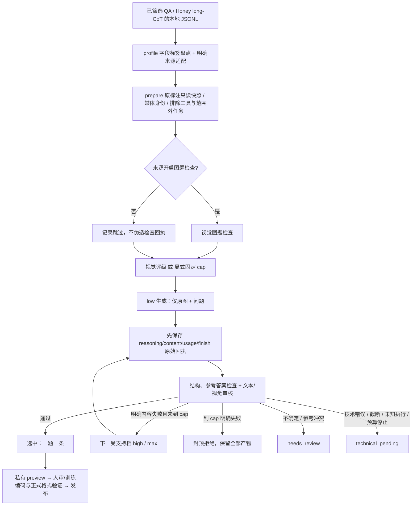

# 图片 CoT v2：评级封顶产线与操作手册

更新：2026-11-06。入口 `run_image_cot.py`；配置版本 `image_cot.config/2`；分支 `codex/image-cot-v1`。
这是实现说明与操作契约，不是真实教师质量或吞吐报告。旧配置 `/1` 保持原短/长链行为；新任务使用 `/2`。

## 1. 复检结论与改动范围

按用户最后确定的政策实现：输入为已有价值筛选的单图单轮 QA，或 Honey 的独立对话；所有可用样本统一重新生成。
图题检查可按来源跳过；评级决定最高可用 effort。每题从 low 开始，首条合格即停止，只有明确内容失败才允许升档。
评级为 high 时最多 low→high，high 失败即封顶拒绝，不请求 max。

这条路径复用 DataStudio 的 Pipeline/SubPipeline、RequestBuilder、MLLMRewriter/MLLMFilter、重复检查和 OpenAI 异步引擎；
复用本分支原有不可变准备输入、RunStore、预算、导出门禁。没有修改通用 DataItem/schema_converter、LMDB、并发引擎或原 run.py。

| 文件 | 改动与目的 |
|---|---|
| `policy.py` | 版本化角色、档位顺序、全局/来源/评级上限取最小值，拒绝 medium 和关闭思考的原生档位 |
| `adapters.py` | 显式 Honey `data[]/messages/from/value` 适配；保留完整原行、图组/对话索引；禁止旧链作为新训练回答 |
| `profile.py` | 全注释流式字段/标签/格式盘点，不枚举或解码媒体；有界私有代表片段 |
| `runner_v2.py` | 分片内可选图题检查、评级、逐档生成和审核；首个合格即停，明确终态与原因 |
| `runner.py` | 新旧共用执行器、动态恢复计账、原生无额外提示词、文本审核不解码图像 |
| `audited_api.py` | 每条请求完成即回调 fsync 保存原始回执，先保存再解析；落盘失败中止派发 |
| `operations.py` | 原生 reasoning/content 渲染、评级和文本审核契约、答案格式适配、v2 审核证据完整性 |
| `export.py` | 从持久回执重算上限、检查候选与所有审核的绑定关系，不能用文本结果伪造视觉通过 |

## 2. 数据链路



原始 Honey `cot_level=long` 不强制 max，也不作为通过凭据。原链归档在原始字段中；不会提供给生成教师或回退为训练回答。
没有 original_answers 或轮次对不上时标为参考未知并待复核，不把新生成答案拿来证明自身。

训练输出仍是单条 conversations；Honey 原始图组只作为元数据保留。导出时显式配置
`export.original_field_mapping`，例如 id→original_group_id、images→original_images、data→original_data；
标准 QA 则将原 conversations 映射到 original_conversations。若来源还有 modal_mask 等保留字段也要显式映射，
冲突会失败，不静默覆盖。学生训练器只编码新的 conversations，原始元数据不能参与 loss；用真实训练探针确认。

## 3. 输入适配与范围

输入为显式 JSONL，媒体为已存在的相对路径。此实现不下载 Honey，不自动将 Parquet/HF Image 对象写成图像文件。
Honey 原始格式的 `images` 是 HF Image 类型，必须在独立、经过审查的材料化流程中先得到本地路径；传入 bytes/dict 会被拒绝。
原始文件和图像不可覆盖；准备输入和工作记录存到代码仓库外的 private_work_root。

标准来源示意：

```python
{
    "schema": "standard_qa_v1",  # Honey 则为 honey_data_v2
    "name": "my_visual_qa", "revision": "immutable-annotation-revision",
    "path": "/data/annotations/source.jsonl", "media_root": "/data/media",
    "max_image_pixels": 16000000,
    "scope_attested_non_math_code": True,
    "task_policy": {"task_type": "open", "reference_grade": "strong"},
    "qa_check_enabled": False, "rating_enabled": True, "effort_cap": "high",
    "excluded_categories": ["math", "code"],
}
```

普通标准输入包含 `conversations=[human,gpt]`、`images=[relative_path]`，问题含一个 `<image>`。
若原回答已有旧 think，必须用 `reference_field` 指向独立参考答案字段；否则参考等级降为 unknown。
Honey 单个 `data` 对话须 `n_turns=1`，messages 为 human/gpt 两条，original_answers 恰有一个非空字符串。
多图、多轮、工具调用、损坏媒体、格式不支持均不隐式修复或拆成无上下文问答；原始行仍可追溯。

本版排除数学解题、证明和代码生成/执行/调试。来源必须显式声明已筛选范围；可配置 allowed_categories、excluded_categories。
不是看到数字或界面代码就剔除。纯 OCR 和框坐标为非 CoT 任务，本版 v2 拒绝进入生成；v1 旁路仍保留。
来源声明不是自动语义分类器；来源混杂时应开图题检查或先做专门范围筛选，审核提示词也检查明显范围错误。

答案适配写入 `task_policy.final_format`：`answer_line`（默认）、`boxed`（支持 `\boxed{}`/`\box{}` 平衡括号）、`plain`。
参考答案另用 `task_policy.reference_format` 明确指定 plain（默认）、answer_line 或 boxed；提取不唯一时待复核，原始字段仍完整保存。
只对声明的格式解析，不猜选项、不拿任意数字当终答。numeric 需独立数值参考与显式容差/单位；mcq 需明确 options 映射。
开放题由裁判作语义对照。格式歧义进入待复核。原生 reasoning_content 与 content 分开读取，再渲染为一对 think；
重复嵌套、双编码、空原生推理、截断或 tool_calls 均不当合格 CoT。

先执行：

```bash
python run_image_cot.py profile -c /private/config/cascade.py
python run_image_cot.py prepare -c /private/config/cascade.py --limit 20
```

profile 扫描全部注释，不看全库媒体；prepare 的 limit 限制展开后的题数，源文件身份仍完整校验。
profile 含字段类型、枚举计数、think/box/answer/tool 格式统计及私有片段。它帮助审查适配，不自动批准来源格式。
遇超长行、字段深度或标签基数超过内存安全上限会失败，不静默截断标签清单。

## 4. 教师、评级与 cap

在仓库外建立私有配置，加载 [`configs/image_cot/kimi_cascade.py`](../configs/image_cot/kimi_cascade.py) 模板；
不要把模板文件原样挪走（其 ROOT 相对于仓库位置计算）。例如：

```python
import runpy
image_cot = runpy.run_path("/path/to/DataStudio/configs/image_cot/kimi_cascade.py")["image_cot"]
image_cot["private_work_root"] = "/private/cot_work"
image_cot["sources"] = [YOUR_REVIEWED_SOURCE_SPEC]
# 填写 limits、quota_pools、各 models 的输出预算和超时，以及 export 的真实路径。
# Windows 路径可写 C:/Users/...；YOUR_REVIEWED_SOURCE_SPEC 用上节来源字典替换。
```

模板故意不填服务预算、工作根目录、来源或超时，填写前不能发正式请求。
生成教师默认使用原生思考：`prompt=None`，不额外要求逐步长篇，不传 gold 或旧 CoT。
角色 generate_low/high/max 分别发送 `reasoning_effort=low/high/max`；max_output_tokens 是输出预算上限，不是推理强度替代品。
教师须回传 reasoning_content 或配对 inline think；仅最终回答不视为成功原生 CoT。

Kimi K3.1 Pro 的 low/high/max 来自[官方模型卡](https://huggingface.co/moonshotai/Kimi-K3.1-Pro)，不发送 medium。
真实账号的 model 名、权限、视觉输入、effort 生效方式与可见推理需小规模实测，模板和 HTTP 200 不证明这些能力。
自部署方式仍支持 IP＋端口＋served model 名：

```python
"lan_teacher": {
    "provider_profile": "openai_compatible", "ip": "192.0.2.10", "port": 8000,
    "api_prefix": "/v1", "model": "your-served-model",
    "auth": {"mode": "none"},
}
```

服务要兼容图文 Chat Completions，并真正支持配置的思考参数。不能把不支持 effort 的服务包装成三档。
需要鉴权时用 env_bearer/key_env，只读环境变量；不要在公开配置里填 token。
DeepSeek 连接可用于纯文本 text_verify 小规模校验；不据此推断其能接图片。评级和图题检查必须使用已验证视觉能力的服务。

全局 policy 默认含：

```python
"tiers": ["low", "high", "max"], "effort_cap": "max",
"fixed_effort_cap": "high", "qa_check_enabled": False,
"rating_enabled": True, "review_mode": "text_only", "regenerate_all": True
```

实际 cap = min(评级 cap 或显式固定 cap，全局硬上限，来源硬上限)。关闭评级必须显式设置 fixed_effort_cap。
无效评级、medium、空 reason 或 JSON 解析失败不会默认 max。来源可单独打开或跳过图题检查/评级。
配置 models 只列实际需要的角色，严格校验；添加 question_check 或 joint_verify 时复制同结构模型条目并指向同名 v2 prompt。
text_then_visual 需 text_verify 和 joint_verify；visual_joint 仅需 joint_verify。评级/图题全关时移除不用的角色。

例：评级 high，low 答案对但理由错→审核 fail→high 生成→通过则选 high；high 再 fail→candidate_rejected，
reason=effort_cap_exhausted。high 超时则 technical_pending；参考冲突则 needs_review；两者均不请求 max。

## 5. 审核模式与质量边界

| 模式 | 调用顺序 | 接受样本的视觉状态 |
|---|---|---|
| text_only（模板默认，符合用户文本裁判链路） | 本地检查→文本裁判 | not_checked，不能声称视觉事实通过 |
| visual_joint（建议作为质量对照基线） | 本地检查→视觉联合裁判 | checked，仍可能误判 |
| text_then_visual | 本地检查→文本通过→视觉联合审核 | 两份审核都必须通过 |

所有审核必须给出具体 reason，并覆盖终答、推理、指令；视觉模式还须有 image:0 的材料性观察。
答案正确但论证错误应 fail。矛盾、循环、遗漏子问、模板填充、无用长篇及额外臆造事实纳入审核。
参考冲突和证据不足应 uncertain。文本裁判不能返回 visual_status 或伪造 visual/image:0 check；违反契约按技术错误保存。
证据种类缺失不能仅靠 all-pass 标志放行。解析器可检查结构与矛盾，不能证明自然语言证据真实或完整。

可接受探索后自我纠正的链，不人为要求字数、反思次数或固定模板。更高 effort 不等于更高质量或更长文本。
所有低档失败产物仍留存，默认每输入问题只选首个合格候选，不默认多链混入训练造成重复加权。
Honey 同题多个原 rollout 展开后仍可能重复；跨来源/同图同题去重和训练配比属于输入批次治理，不因新 candidate_id 自动解决。

纯文本裁判挡不住隐藏的视觉幻觉。正式放量前要用真实图像独立人审，并用视觉联合模式作对照，按来源/effort/失败类型统计误接收。
已有正式发布要求继续有效：独立质量审计、真实学生编码/损失/训练探针、当前 data_format 与完成版中文 README 验证。
这次实现不声称已经验证模型质量、学生收益、生产吞吐或实际交付格式。

## 6. 每步保存、恢复与重审

工作区包含 prepared、profiles、runs/JOB_ID/run.json、parts、selection、report 及执行观察。
每次派发先写 intent；每个完整 HTTP 响应结束后立即把完整原始 JSON、reasoning_content、content、finish_reason、usage、
provider request ID、HTTP 状态、请求摘要和错误 fsync 到私有日志；无需等待同批慢请求完成。
非 JSON 错误保存有界原始 body；超大响应仅保存已读取的有界片段并标记不完整，不伪装为完整 CoT。
进程收到完整响应前崩溃、连接中断或磁盘失败仍可能无法取得完整结果，这种 intent 保留为未知，不自动重发。
文件 fsync/目录同步能力受平台和共享存储影响；本地 Windows 验证不代替服务器文件系统故障测试。

```bash
python run_image_cot.py check -c /private/config/cascade.py --backend http
python run_image_cot.py run -c /private/config/cascade.py --limit 20
python run_image_cot.py resume --run /private/work/runs/JOB_ID
python run_image_cot.py report --run /private/work/runs/JOB_ID
python run_image_cot.py export --run /private/work/runs/JOB_ID --preview
```

check 只做配置预检；不联网探测能力。run 返回路径后用 report 查看终态；有 pending 时 CLI 退出码 4。
resume 要求原代码身份和冻结配置不变；动态恢复所有实际 v2 阶段的请求/token，不因重启清零。
已落盘强模型响应可直接重新解析，不重调教师。未知执行不隐式补发，避免重复付费。

更换审核模型、prompt 或版本时，建新运行，配置 reuse_from=[旧运行目录]；生成配方和输入身份未变则复用已保存的新候选回执，
只重审。它与复用 Honey 旧 CoT 不同。源码或生成预算/提示/参数改变会改变配方身份，不能当同一候选复用。
v2 不接受 v1 review_resolutions 人工覆盖，通过新审核运行形成可校验回执；有争议的样本保持待复核。
改变来源 cap 或开关需重新 prepare；不会把旧准备输入的政策悄悄带入新运行。

私有工作区仍需按部署环境做存储快照/备份；在停止写入后备份整个 prepared/run 与 manifest，校验摘要，不仅复制最终选中 JSON。
原始响应、私有 QA、图片、真实配置、日志、缓存均不提交 GitHub。GitHub 只备份代码、合成测试和文档。

## 7. 速率与放量

选择首个合格后停止；只为明确失败升级；可跳过已完成的图题检查；文本审核不传图、不解码图片；
共享异步并发、微批、RPM/输入输出 TPM 配额，恢复不重复发已付费请求。未重写并发或数据库引擎。
逐条 fsync 保障强模型产物保留，会增加 IO 延迟；是否瓶颈必须在目标存储测量，不能以 mock 的秒数承诺生产速率。

每来源有效调用期望约为：可选 QA + 可选评级 + 触达各档的生成 + 各档实际审核。
用 execution observation 的新请求、阶段时间、cache hits 与来源统计，结合真实通过率、token 和配额再做预算。
max_requests_total、max_output_tokens_total、max_wall_time_s 及每请求输出、响应/请求字节、像素、并发和账户配额必须明确。
当前只有请求/token/时间硬预算，没有美元硬封顶或精确视觉 token 预测；input_tokens_per_request 要保守校准。
首批规模和配额未定，实际吞吐尚未验证。建议先 20 条接线，再做按来源分层的小批人审和真实限流测量。

## 8. 提示词来源与验收

生成默认不加额外 CoT 提示，只用模型原生接口；这不保证任意开源服务都公开 reasoning。
评级、图题检查、文本及视觉审核 prompt 为本项目编写；不是 Honey 官方生产 prompt 的逐字复现。
视觉审核维度参考 [RLAIF-V 的细粒度视觉反馈](https://arxiv.org/abs/2405.17220)，
同图多对话结构依据 [Honey 官方数据卡](https://huggingface.co/datasets/HoneyDataV2/Honey-Data-V2/blob/main/README.md)。
结构化 JSON、状态、cap 和证据字段是本项目工程契约，不应宣传成论文原始格式。

本地验收覆盖范围见 [v2 验证记录](image_cot_v2_validation_2026-11-06.md)。真实模型 API、服务端 effort 生效、
视觉误接收率、人审质量、跨源泄漏、训练收益与生产存储容错仍须运行验证。
