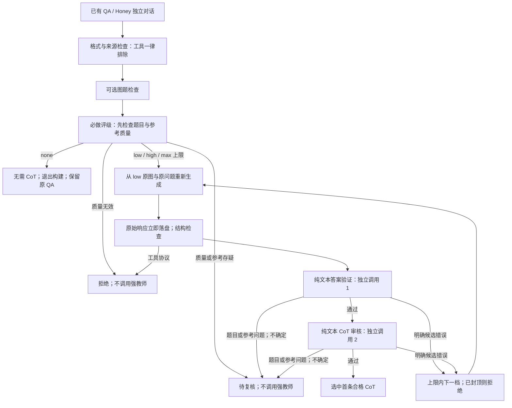

# 图片 CoT v3：四档评级与两步文本审核

日期：2026-11-06；入口 `run_image_cot.py`，配置 `image_cot.config/3`。
本页记录按用户最新五项要求实现的产线。v1/v2 继续作为历史兼容路径，新任务使用
[`configs/image_cot/kimi_split_text.py`](../configs/image_cot/kimi_split_text.py)。
真实模型的评级准确率、审核质量、吞吐与学生收益尚未验证；本地测试不构成这些指标的证明。

## 1. 数据流与停止条件



每个调用都先写 intent，再逐响应保存完整原始回执；解析失败、审核失败、封顶失败不删除产物。
超时、截断、解析错误、未知执行与预算未派发进入 technical_pending，不靠升档规避技术问题。
同一题评级 high 时只允许 low→high；high 明确失败就是 effort_cap_exhausted，不调用 max。

## 2. 工具排除

输入在任何参考答案改写之前递归检查。工具角色、工具调用/结果、function 调用、工具声明和工具协议标记均排除；
包含工具的原始 Honey 图组也整体排除。来源中的空工具声明/字段不当作普通 QA 洗掉。
原消息角色先验证为 human/gpt，再提取 reference_field，不能通过重建 gpt 消息掩盖非法角色或工具字段。

评级、生成、答案验证、CoT 审核的模型响应中出现真实工具调用或工具协议，也立即退出，不再升档。
原始回执先保存，拒绝原因为 tool_protocol_excluded。服务响应序列化附带的 tool_calls=null/[] 没有工具操作，
不视为实际工具调用；只要里面有调用内容就排除。普通问句中的“锤子是什么工具”等自然语言不按工具协议误杀。

## 3. 四个评级与题目质量分离

| 评级 effort_cap | 含义 | 强教师路径 |
|---|---|---|
| none | 合格问题，但直接回答已足够，额外推理没有监督价值 | 零生成、零答案审核、零 CoT 审核；终态 not_required_cot |
| low | 值得解释的少量必要推理 | low |
| high | 多个依赖关系或约束需要组合 | low→high，首个合格即停 |
| max | 证据充分、题目有效且确有很强推理负担 | low→high→max，首个合格即停 |

这四档是业务评级；none 不会作为教师的 reasoning_effort 参数发送。实际生成档位仍为 low/high/max，不发送 medium。
评级模型必须接收图片、问题与独立参考答案；旧 Honey CoT 不交给它，不以旧 cot_level 或长度推断难度。
生成教师仍只接原图和问题，不接参考答案、旧链或前档错误链。

评级响应版本 `image_cot.effort_rating/2`：

- task_status 为 answerable / invalid / uncertain，先判断题目和参考是否可用。
- 仅 answerable 可以给 none/low/high/max；invalid/uncertain 必须 effort_cap=null。
- checks 必须覆盖 question_quality、reference_quality、reasoning_need、effort，并给出具体 claim、证据来源、finding 与 reason。
- 不能确定题目或参考是否成立时，不能把不确定性转换为 high/max；输出矛盾或字段缺失按技术错误保留。

明确的题目缺失、不可补全的条件或范围错误拒绝；参考冲突与证据存疑待复核。已由来源标为弱参考的数据提前待复核，
不浪费评级或强教师请求，也不会被模型自动升级成可信 gold。
纯 OCR/框标注可进入 v3 评级并退出为 none；如果评级和已声明的非推理任务类型冲突，待复核而不强行生成。

评级在 v3 必做，禁止全局或来源关闭。全局/来源 effort_cap 只能收紧评级上限，不能放宽。
none 是合格任务的“无需 CoT”，不等于输入错误，也不把原有 Honey 长链直接作为新训练响应导出。

## 4. 答案与 CoT 两次独立文本调用

| 项目 | answer_verify | reasoning_verify |
|---|---|---|
| 触发 | 候选结构可用 | 答案验证通过 |
| 输入 | 原题/使用题、独立参考、最终答案、任务约束及选项 | 同前，再加候选推理文本 |
| 不接收 | 候选 CoT、图片 | 图片 |
| 判断 | 终答正确性、所有子问、单位/选项/格式等 | 推理必要性、自洽、前提与结论、错误/循环/冗余 |
| Schema | cot.answer_judgment/1 | cot.reasoning_judgment/1 |

两份 prompt 分别为 [answer_verify.txt](../prompts/image_cot/v3/answer_verify.txt) 与
[reasoning_verify.txt](../prompts/image_cot/v3/reasoning_verify.txt)。它们是本项目工程提示词，不是论文原文。
指令模板中没有视觉审核要求或图像判定维度，schema 也没有 visual_status/image:0。
题目原文是被审核的数据，照常保留；不会为避免题目出现“图”等字而改变问题。
两个 role 可以用同一个纯文本推理服务，也可以分别使用不同模型；始终是两次独立 API 请求和两份持久回执。

结果必须包含 status、failure_kind、critical_errors、uncertainties、checks、reason。
答案审核覆盖 answer/instruction；CoT 审核覆盖 reasoning/consistency。pass 必须有一致的具体证据，不能仅给通过标志。
正确终答不替代正确推理；简短充分的推理可通过，不要求长篇、固定阶段或人为反思。

只有 failure_kind=candidate 的明确失败才升档；reference/input 问题、不确定结果和技术错误不升档。
本地数值/选项检查在 v3 作为辅助记录，不提前截断独立答案裁判，以便识别错误参考而非盲目追 gold。
结构崩溃、占位符泄漏或严重重复等低成本错误仍可直接过滤，不为明显坏格式支付两次审核。

两份文本审核不能独立证明图中事实真实；输入图题检查和评级也不证明后来新增的每条推理事实。
该边界记录在输出侧车的 visual_audit=not_checked；本次不增加视觉联合审核调用。
真实数据质量仍需独立抽样评估，不把文本通过宣称为逐条视觉事实已验证。

## 5. 保存和统计

| 产物 | 内容与定位 |
|---|---|
| prepared + input_manifest | 原始注释、媒体身份、来源政策与展开后的题目记录 |
| 每阶段 plan.json | 输入分片、角色、任务/候选 ID、配方与父提交 |
| 每阶段 journal | 先 intent，后逐响应完整 raw、reasoning_content/content、finish_reason、usage、错误与请求摘要 |
| 每阶段 results + commit.json | 结构化结果、reason、评级依据或审核 checks、不可变提交摘要 |
| statistics/阶段/摘要.json | 每个已完成阶段分片的计数、usage 与父提交引用，后续阶段中断也保留 |
| selection | 最终状态、实际评级、评级原因、有效 cap、全部尝试、两份审核引用与理由 |
| report.json | 总终态、四档分布、质量决策、每来源结果、各 effort 结果、各阶段统计 |
| execution observation | 本次执行时间、请求增量、缓存命中、阶段耗时、fsync 耗时 |

stage_statistics 为每个已配置阶段提供 planned、各状态计数、原因、failure_kind、回执数、已知/未知 usage、
观察到的输入/输出 token 和响应耗时合计。没有调用的阶段也有零统计；并行响应时间合计不是端到端墙钟时间。
rating_distribution 统计 answerable 的 none/low/high/max；not_rated 仅指提前退出且未评级。
rating_decisions 单独统计 answerable/invalid/uncertain/error 等，不能把无效题混进 none。
未知 usage 不伪填为零成本；预算总账继续按既有保守预留规则计账。

raw 回执在解析之前 fsync。发生 bad JSON、审核拒绝、进程中断时都保留已完成响应；恢复不会重复调用已有回执任务。
尚未收到完整响应时连接中断或主机故障，不能保证取得完整结果；未知执行不隐式重发。
修改裁判提示/版本时用新运行的 reuse_from 复用同一生成配方的新候选；跨源码版本不承诺自动迁移旧回执。
发布到 GitHub 的只有代码、提示词、测试和文档，真实 QA、图片、回执、日志与私有配置不进入代码仓库。

## 6. 配置、运行和评级校准

在仓库外用私有 Python 配置加载模板，不能将模板原样移走后继续依赖其相对 ROOT：

```python
import runpy
image_cot = runpy.run_path("/path/to/DataStudio/configs/image_cot/kimi_split_text.py")["image_cot"]
# 配置 private_work_root、sources、各角色服务、max_output_tokens、超时、limits、quota_pools 和 export。
```

角色：effort_rating（视觉模型）、generate_low/high/max（强教师）、answer_verify 与 reasoning_verify（纯文本推理模型）。
如开启 qa_check_enabled，再配置 question_check 与对应 prompt。自部署服务继续使用 IP＋端口＋model 名；
不同账号/服务配置真实配额，同一账号不能借不同角色重复放大 RPM/TPM。
按角色配额自动细分微批；单请求本身就超过配额时预检失败，不等付费生成之后才发现审核配置不可执行。

```bash
python run_image_cot.py profile -c /private/cot_config.py
python run_image_cot.py check -c /private/cot_config.py --backend http
python run_image_cot.py run -c /private/cot_config.py --limit 20
python run_image_cot.py report --run /private/work/runs/JOB_ID
python run_image_cot.py resume --run /private/work/runs/JOB_ID
python run_image_cot.py export --run /private/work/runs/JOB_ID --preview
```

20 条仅是接线示例，不是评级准确率或产线质量的统计保证。真实服务与预算未提供，本轮未发付费请求。
通常一条首档合格题需要评级＋生成＋答案审核＋CoT 审核，共四次调用；none 或评级发现质量问题只花评级调用。
答案未过则省去该候选的 CoT 审核。提高档位不修复坏题，绝不因此突破 hard cap。

要评估评级准确性，另提供独立人工标注 JSONL，每条包括 question_id、task_status、effort_cap、reviewer。
answerable 的 effort_cap 为四档之一；其余为 null。question_id 来自 selection，不凭顺序对齐。
例如（值为示意，不是已验证标注）：

```json
{"question_id":"actual-question-id","task_status":"answerable","effort_cap":"low","reviewer":"annotator"}
```

```bash
python run_image_cot.py rating-report --run /private/work/runs/JOB_ID --labels /private/rating_labels.jsonl
```

该命令不调用模型，校验保存的评级回执与标签 ID，输出到 run/reports，含四档混淆矩阵、质量决策混淆、
不必要 CoT、漏掉 CoT、高估/低估、不必要 high/max、坏题误判可答，以及技术失败/提前退出。
标签最多 10,000 条以控制内存，必须唯一且属于该 run；原始标签文件记录摘要。
这是与所提供标签的一致性统计，不保证标注本身正确，也不是自动发布许可。

建议先按来源和问题类型分层独立标注，重点看 none 与 low 的边界、坏题误判可答和 high/max 高估，
据此调整 prompt 或来源 cap，再用未用于调参的独立批次确认。阈值和规模需以实际样本成本/错误代价确定，不凭空承诺准确率。

## 7. 改造范围、验证与待办

新增 v3 编排和审核合同，继续复用既有 RunStore、预算器、Pipeline、请求构建与异步引擎，未重写 LMDB/并发核心。
新 prompt 的档位边界和质量/难度分离来自用户本次约束与本项目的成本控制选择；尚无真实评级准确率证据。
替代方案包括只靠文字长度评级、失败就无条件 max、合并答案与推理审核；它们不作为本次默认，因为与用户需求不符。
若独立标注显示没有减少无意义高档调用或 none 漏判严重，应调整 rubric/来源策略，而不能继续宣称评级可靠。

前次审查 R1/R2 已修复；旧 v2 视觉合同 R3 也堵住来源开关旁路，v3 本身仅使用两份文本审核；R4 已按角色拆批并预检单请求。
R5（Honey 完整原图组重复保存）仍是规模待办，本轮未静默删减原始字段以规避交付合同。不要据此宣称 Honey 全规模吞吐已经验证。
已重读当前 data_format.md；正式发布仍需实际 JSON/媒体/完成版 README 和学生编码探针，本轮未发布真实数据或宣称严格交付合规。
具体本地验证范围见 [v3 验证记录](image_cot_v3_validation_2026-11-06.md)。
